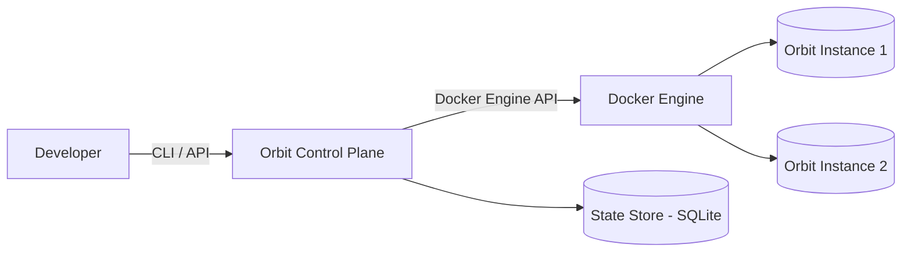
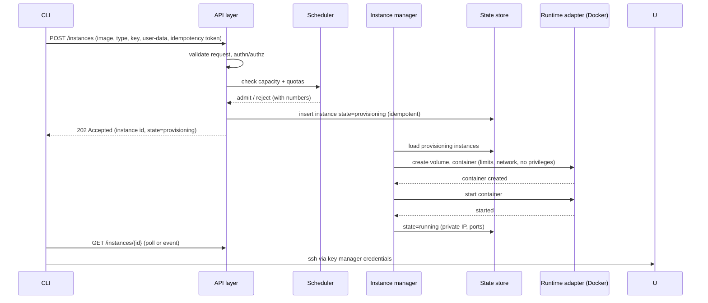

# Orbit — Architecture

> **Status: Proposed.** Single-host, modular monolith. Deliberately **not** microservices: Orbit runs on one laptop and must stay simple to install, run and debug. The architecture's key commitment is a **runtime abstraction** so a QEMU/KVM backend can be added later without redesigning the control plane.

Related: [requirements.md](requirements.md) · [technical-design.md](technical-design.md) · [security.md](security.md) · [data-and-api.md](data-and-api.md)

## 1. System Context



One host machine runs: the Orbit control plane (single process), the Docker Engine, and any number of Orbit Instances (containers on an Orbit-managed bridge network).

## 2. Component Overview

| Component | Responsibility |
|---|---|
| **API layer** | REST/gRPC-style API used by the CLI and (later) web UI. Request validation, authn/authz (token-based, even locally), error mapping. |
| **Instance manager** | Lifecycle orchestration: implements the state machine, enforces per-instance single-transition, idempotency. |
| **Scheduler / capacity manager** | Knows host capacity and per-type costs; admits or rejects provisioning requests; enforces quotas. |
| **Runtime adapter** (interface) | The *only* component that talks to the container runtime. Contract: create/start/stop/remove units, attach networks/volumes, apply limits, stream stats/logs, inspect state. Implementation 1: Docker. Future: QEMU/KVM. |
| **Network manager** | Owns the Orbit bridge network, private IP allocation, port publishing. |
| **Storage manager** | Root volumes and (later) named volumes; persistence mapping. |
| **Key manager** | SSH key registration; injects public keys at instance bootstrap. |
| **Reconciler** | Background loop: compares desired vs actual state, detects crashed instances, cleans up orphans after host restarts. |
| **State store** | SQLite: the single source of truth for instance/key/volume/network records. |

## 3. Control Plane vs Execution Plane

- **Control plane** = everything above except the runtime adapter's backend: validation, scheduling, state, orchestration, API. It never runs user workloads and never talks to containers except *through* the runtime adapter.
- **Execution plane** = the Docker Engine plus the instances it runs: containers, networking (bridge), storage (volumes), sshd inside guests, resource enforcement (cgroups via Docker).

The boundary is the **runtime adapter interface**. The control plane reasons in Orbit concepts (instances, types, volumes); the execution plane reasons in runtime concepts (containers, networks, volumes). This is the seam where a VM backend will later plug in.

## 4. Key Flows

### 4.1 Instance creation (asynchronous)



Create is **asynchronous**: the API admits the request and returns immediately; the instance manager performs the work. Reason: image pull and boot take tens of seconds; blocking would make the CLI fragile, and async models real cloud behaviour (EC2 `pending`). Stop is likewise async with a short timeout; list/describe/terminate-confirmation are synchronous.

### 4.2 Termination

1. API validates the request (explicit confirm flag — irreversible).
2. State → `terminating` (blocks other transitions).
3. Instance manager: stop container (graceful timeout) → remove container → remove root volume (unless keep flag) → release ports.
4. State → `terminated`; record is retained for a grace period for auditability, then garbage-collected by the reconciler.

### 4.3 Failure detection and recovery

- **Reconciler loop** (every few seconds): for each instance not in a terminal state, `inspect` via the runtime adapter.
  - Runtime reports exited → state = `stopped` (clean exit) or `failed` (non-zero/OOM) with reason.
  - Record exists but runtime object is missing → `failed` with `orphaned` reason (host restored from snapshot, manual deletion).
  - Host rebooted: runtime objects are gone → all non-stopped instances reconciled to `stopped`/`failed`; the user chooses what to restart (Orbit never silently auto-starts on boot — this mirrors a stopped EC2 instance after a host maintenance event, which is also the honest behaviour).
- **State store as source of truth:** the runtime is *observed*, not trusted; every discrepancy is resolved through the reconciler, never by editing state in place from the API layer.
- **Control-plane crash mid-provisioning:** provisioning is resumable — the reconciler either completes or rolls back partial objects (delete the half-created container/volume).

## 5. Instance State

Maintained in SQLite (see [data-and-api.md §State machine]): `pending → provisioning → running ⇄ stopped → terminating → terminated`, plus `failed`. Rules:

- Exactly one active transition per instance (serialized in the instance manager).
- Every state row includes `updated_at` and `transition_error` where relevant.
- The runtime never mutates Orbit state directly; only the reconciler translates runtime observations into state changes.

## 6. Component Communication

- **CLI → control plane:** HTTP REST on localhost (default `127.0.0.1:<port>`, loopback-only in MVP). Same API for future web UI — no privileged CLI shortcuts.
- **Runtime adapter → Docker Engine:** official Docker Engine API over the local socket/named pipe (platform-dependent; see [technical-design.md]).
- **Control plane internals:** in-process function calls in a modular monolith; module boundaries are package boundaries, enforced by keeping the runtime adapter the only Docker-importing package.

## 7. Evolution: additional runtimes (QEMU/KVM)

The runtime adapter interface is defined around Orbit semantics, not Docker specifics:

```text
RuntimeAdapter {
  CreateUnit(spec{resources, volumes, network, bootstrap, security}) -> handle
  Start/Stop/Remove(handle)
  Inspect(handle) -> status, exitInfo, addresses
  Stats(handle), Logs(handle)
}
```

A future `QemuAdapter` implements the same contract with libvirt/QEMU (real VMs, stronger isolation — see [security.md §Trust model]). Nothing in the control plane changes except configuration selecting the backend, plus image formats (qcow2 vs Docker images) behind an image-manager abstraction. This is the reason container-specific details (image layers, `-p` flags) are kept inside the Docker adapter.

## 8. What Is Deliberately Absent

- **No message broker / event bus** — the reconciler loop plus SQLite is sufficient at this scale.
- **No separate scheduler service** — capacity math is trivial single-host arithmetic.
- **No agent inside instances (MVP)** — sshd + user data cover the experience; an in-guest agent is a P2+ consideration tied to the metadata endpoint.
