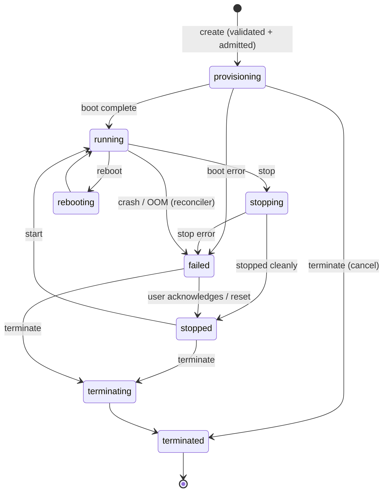

# Orbit — Data Model and API Design

> **Status: Proposed.** Entities are the minimum set that satisfies [requirements.md](requirements.md). API is REST/JSON on localhost; all requests require a bearer token ([security.md §6.1]). Everything below is MVP unless marked **[P1]/[P2]**.

## 1. Entities

| Entity | Purpose | Notes |
|---|---|---|
| **Instance** | A compute resource | The core entity. |
| **InstanceType** | Predefined CPU/memory flavours | Static catalogue (config-defined, not user CRUD). |
| **Image** | Curated bootable template | Read-only catalogue in MVP. |
| **SSHKey** | Named public key | Public key + fingerprint stored; private key never server-side. |
| **Volume** | Persistent storage | One root volume per instance in MVP; attachable volumes [P1]. |
| **Network** | The Orbit bridge network | Implicit single network in MVP; entity exists to model it and allow P1 segmentation. |
| **SecurityGroup** *(no)* | — | **Not modelled in MVP.** Rules are deny-by-default + port publishing. Introduce with the P1 SG feature ([feature-priorities.md]). |
| **InstanceEvent** | Audit/log of state transitions and errors | Written by the instance manager/reconciler; powers `describe` history. |
| **Tag** *(no)* | — | Key-value tags deferred to P1 ([feature-priorities.md]); no entity yet. |

### 1.1 Instance

```text
Instance
  id            string   ulid, "orb-..."        immutable
  name          string   unique, DNS-ish label  required (idempotency anchor)
  state         enum     see §2
  image_id      string   ref Image
  type_id       string   ref InstanceType
  key_id        string   ref SSHKey
  user_data     string?  startup script (shell)
  private_ip    string?  set when running
  ports         list[PortMapping]  {host_port, instance_port, bind:"loopback"|"all"}
  created_at / updated_at  timestamp
  transition_error string?  last failure reason
  owner         string   reserved ("local" in MVP)
  root_volume_id string  ref Volume
```

### 1.2 Others (abridged)

```text
Image:        { id, name, os, description, size_bytes, tags[] }        # read-only
InstanceType: { id, vcpu, memory_mb, description }                     # static
SSHKey:       { id, name, public_key, fingerprint, created_at }
Volume:       { id, instance_id?, name, size_hint_gb, persistent, created_at }
Network:      { id, name, subnet, state }
InstanceEvent:{ id, instance_id, type, message, occurred_at }
```

**Relationships:** Instance 1—1 root Volume (P1: 1—N volumes); Instance N—1 Image, InstanceType, SSHKey; Instance N—1 Network (MVP always the same one); Instance 1—N InstanceEvents.

## 2. Instance Lifecycle State Machine



Rules: exactly one active transition per instance; every transition is a transaction that appends an `InstanceEvent`; only the reconciler may set `failed` from runtime observations ([architecture.md §4.3]). `stopped` and `failed` are the only non-terminal states that permit delete/terminate. State data survives Nebula restarts (SQLite, WAL).

## 3. API Contracts

Base: `http://127.0.0.1:{port}/v1` · Auth: `Authorization: Bearer <token>` on every request · Content: JSON · Errors: structured (§3.4).

### 3.1 MVP Endpoints

| Method & Path | Purpose | Sync/Async |
|---|---|---|
| `POST /instances` | Create instance | Async (202) |
| `GET /instances` | List (filter: state, name) | Sync |
| `GET /instances/{id}` | Describe (includes last events) | Sync |
| `POST /instances/{id}/start` \| `/stop` \| `/reboot` \| `/terminate` | Lifecycle actions | Async (202) |
| `PUT /instances/{id}/ports` | Replace port-publish mappings | Sync |
| `GET /instances/{id}/logs` | Tail instance logs | Sync/stream |
| `GET /instance-types` · `GET /images` | Catalogues (read-only) | Sync |
| `POST /keys` · `GET /keys` · `GET /keys/{id}` · `DELETE /keys/{id}` | SSH key management | Sync |
| `GET /capacity` | Host budget, usage, quotas | Sync |
| `DELETE /keys/{id}` with in-use check → `409` | See validation below | Sync |

`POST /instances` request/response:

```json
// Request
{
  "name": "web-1",                          // required, unique, ^[a-z][a-z0-9-]{2,30}$
  "image_id": "ubuntu-24.04",               // required, must exist
  "type_id": "orbit.micro",                 // required, must exist
  "key_id": "dev",                          // required
  "user_data": "#!/bin/sh\n...",            // optional, ≤ 16 KiB
  "ports": [{ "instance_port": 8080, "host_port": 0, "bind": "loopback" }],  // host_port 0 = auto
  "idempotency_token": "b3f9..."            // required (or rely on unique name)
}
// 202 Response
{ "id": "orb-01J...", "name": "web-1", "state": "provisioning",
  "image_id": "ubuntu-24.04", "type_id": "orbit.micro",
  "created_at": "2026-11-10T12:00:00Z" }
```

### 3.2 Future Endpoints [P1/P2]

Volumes CRUD + attach/detach [P1] · security groups + rules [P1] · instance metadata endpoint [P1] · metrics samples [P1] · image registration [P1] · snapshots [P2] · stacks/IaC [P2].

### 3.3 Validation Rules (summary)

| Field | Rule |
|---|---|
| `name` | Unique among non-terminated instances; regex above; not an existing id. |
| `image_id` / `type_id` / `key_id` | Must exist. Deleting an in-use key → `409`. |
| `type_id` capacity | Admission check ([technical-design.md §12]): allocation + request ≤ schedulable budget AND ≤ quotas; else `422` with requested-vs-available. |
| `user_data` | ≤ 16 KiB, UTF-8, must begin with a shebang. |
| `ports` | Instance port 1–65535; host port 0 (auto) or 1024–65535; no duplicate host ports; `bind` ∈ {loopback, all} (all → warning in response). |
| Idempotency | Same `idempotency_token` (or `name`) while a matching instance exists → return that instance (`200`), never a duplicate. |

### 3.4 Error Responses

```json
{ "error": { "code": "insufficient_capacity",
    "message": "Requested 2 GB memory; only 1.2 GB of the schedulable budget remains.",
    "details": { "requested": { "memory_mb": 2048 }, "available": { "memory_mb": 1229 } } } }
```

Codes: `validation_failed` (400/422 with details) · `unauthorized` (401) · `not_found` (404) · `conflict` (409 — duplicate name, in-use key, instance mid-transition) · `quota_exceeded`, `insufficient_capacity` (422) · `runtime_error` (503 — Docker unavailable; retriable). Errors reference the failing instance/event where applicable; internal runtime details are never leaked into messages beyond what's actionable.

### 3.5 Authn/Authz Requirements

- Bearer token, generated at first run, `0600`, loopback-only listener ([security.md §6.1]).
- Single user, full permissions in MVP; `owner` fields present for future multi-user.
- Every request authenticated; no anonymous even for "read" endpoints.
